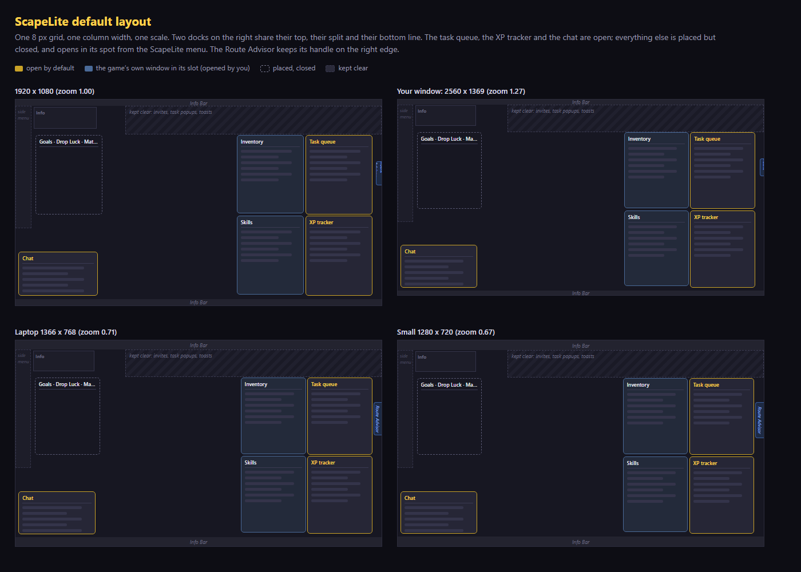

# ScapeLite default layout

A clean, ready-made arrangement of your panels, worked out for the window you actually have. It is **opt-in**: nothing moves until you press it, your own layouts are never touched, and **Back to my old layout** puts everything back (positions, sizes, scales, the game windows' scales, tab groups, your look, and which panels were open).



## Try it

- First run: the welcome tour has a **Your panel layout** step with a button. Press **Next** to keep what you have.
- Layout Editor (Ctrl+Alt+L, or **Edit Layout** in the ScapeLite menu) > **ScapeLite default**.
- Or Settings > Plugins > Panels > **ScapeLite Default Layout** > Use it.
- To undo: **Back to my old layout** (Layout Editor or the same settings page).
- Pressing **ScapeLite default** again (for example after changing the window size) rebuilds it for the new size; the first "old layout" backup is kept.
- Tinker freely afterwards: the arrangement is the layout called `ScapeLite default`, so every move you make is saved in it. Use **Save as...** first if you want to keep your tinkering, because pressing the button again rebuilds the arrangement.

## What was wrong with the first version

Testers found it messy. Looking at it like a designer: three columns of three different widths (378, 302, 378), ScapeLite panels at four different scales (80, 90 %...), tops and bottoms that did not line up, the XP tracker wider than the queue and a few pixels off its edge, a Route Advisor floating in the middle, and every panel placed as if all of them would be open at once. It looked like a pile of boxes.

## The design rules

| Rule | How |
| --- | --- |
| One grid | 16 px margin to the left, top and bottom edges; 8 px gutter between panels; every x and width a multiple of 8 |
| One column width | 352 px: the task queue, XP tracker, the game's windows and every pinned card are exactly that wide |
| One scale | Every ScapeLite panel at 15/16 of the game's own size, so text is the same size everywhere |
| Shared lines | The two right-hand docks start at the same y, split at the same y and end at the same bottom edge |
| Few windows | Only the **task queue, XP tracker and chat** are open. The rest is placed but closed |
| Clear zones | The top 150 px (right 70 %) stays empty for invites, task popups and toasts; the game's Info panel and left tab strip are not touched |
| A rail for the Route Advisor | The right margin is 48 px: the Route Advisor keeps its own handle on the right screen edge and the docks leave it room |

```
 top Info Bar
 Info (game)        keep clear: invites, task popups, toasts
 Helpers (closed,                                    Inventory type | Task queue
 tab group)                                          ---------------+-----------
                                                     Skills type    | XP tracker
 Chat
 bottom Info Bar
```

| Spot | Holds | Why there |
| --- | --- | --- |
| Right dock, right column | Task queue (top), XP tracker (bottom) | What you look at most sits at the edge, out of the middle of the game. The game's own Tasks window is not moved: the queue replaces it |
| Right dock, left column | Slot A (top): Inventory, Equipment, Barter. Slot B (bottom): Skills, Quests, Diary, Friends | A game window and the pinned card of the same family share one spot; pinned cards also become a tab group, so opening two shows a tab strip |
| Left, under the Info panel | Goals, Drop Luck, Materials, Tree Advisor, Advisor, Locations and Free Pips as one tab group (closed) | Helpers you open now and then from the ScapeLite menu. The last two keep their own width because they are wide tables |
| Bottom left | Chat | Reads like the game's own chat; the left tab strip ends well above it |
| Right screen edge | the Route Advisor's handle | Not moved by the layout |

On a window taller than 16:9 the bottom row of both docks grows, so the docks always end 16 px above the bottom Info Bar. On a wider window the extra room is added in the middle, never between the docks.

Not moved: the game's Info panel, Current Task, Raid DPS, Fortress, the Tasks window, the left tab strip, the Info Bars, the HP panel and the alert bell.

## Which panels are open

Applying the layout leaves **only the task queue, the XP tracker and the chat** open. Goals, Drop Luck, Tree Advisor, Advisor and Locations and Free Pips are closed (open them from the ScapeLite menu: they land in their spot). The Route Advisor, Materials and pinned cards are left as they are. **Back to my old layout** reopens what was open before and closes what the layout opened.

## Sizes and scale

Scale uses the on-screen convention of the size menu: 100 % is unscaled. ScapeLite panels get 93.75 % times `f`; the game windows get 352 px of width, about 94 to 96 % of their own size at your zoom. The stored multiplier is that divided by the game's zoom and your global panel size, so it keeps working if you change either.

`f = min(width / 1920, usable height / 1012)` (a 1080p window minus two 34 px Info Bars is 1920 x 1012), kept between 0.55 and 1.6. Below `f = 0.7` the 48 px right margin is replaced by a 34 px real-pixel rail, so the Route Advisor handle never touches a dock.

The look (colours, spacing, text size, accent) is set to the ScapeLite defaults, so the layout reads like the Design Lab. **Back to my old layout** restores your own look.

## Per window size

Positions are real screen pixels, Info Bars on. `x,y width x height`.

| Window | f | Task queue | XP tracker | Slot A | Slot B | Helpers | Chat |
| --- | --- | --- | --- | --- | --- | --- | --- |
| 1920 x 1080 | 1.00 | 1520,186 353x416 | 1520,610 353x420 | 1160,186 353x416 | 1160,610 353x420 | 104,186 353x416 | 16,798 416x232 |
| 2560 x 1369 (zoom 1.27) | 1.29 | 2045,229 453x535 | 2045,774 453x540 | 1582,229 453x535 | 1582,774 453x540 | 134,229 453x535 | 21,1017 535x298 |
| 1366 x 768 (zoom 0.71) | 0.69 | 1088,139 244x288 | 1088,432 244x291 | 839,139 244x288 | 839,432 244x291 | 72,139 244x288 | 11,563 288x160 |
| 1280 x 720 (zoom 0.67) | 0.64 | 1019,132 227x268 | 1019,405 227x271 | 787,132 227x268 | 787,405 227x271 | 67,132 227x268 | 10,527 268x149 |

(`npm run test:default-layout` prints the exact numbers it checks; `node scripts/test-default-layout.js --preview=docs/default-layout-preview.html` redraws the preview and `node scripts/shoot-page.js docs/default-layout-preview.html docs/default-layout-preview.png 1400 1000` makes the picture.)

Very small windows (under about 1280 wide) shrink everything with `f`, so text gets small; the layout stays tidy but you may want fewer panels open there.

## What the test proves

`scripts/test-default-layout.js` has two parts and never touches the real game:

1. **Arithmetic**, at ten window sizes with and without Info Bars (1024 x 768 up to 3840 x 2160): every panel inside the usable area, panels of different spots never overlap, the notification band and the left tab strip stay clear, sizes respect the panels' minimums, every id is one the layout import accepts. And the design rules above: the same width for everything docked on the right, shared top / split / bottom lines, equal gutters (8 design px) and margins, the 8 px grid at `f = 1`, one scale for all ScapeLite panels, the Route Advisor rail, and exactly three panels open.
2. **The real `ui-layout.js` and `default-layout.js`** on a fake game shell in a private hidden window: panels land within 3 px of the arithmetic at four window sizes, the tab strips appear, only the three panels are left open, **Back to my old layout** puts everything back (positions, sizes, scales, open panels), your own saved layouts survive, and a game window you move by hand stays where you put it.

## How it works (for plugin authors)

- `overlay/default-layout.js` is pure arithmetic (no DOM): `build({ w, h, top, bottom, zoom, g })` returns the layout store entries, tab groups, look, the scales for the game's windows, the on-screen rectangles the tests check, and `open` / `close`, the plugin namespaces (`NS`) to have open or closed afterwards.
- `ui-layout.js` stores the result as the layout `ScapeLite default`. A game window entry carries `tx`/`ty`, the on-screen spot to land on; when the window opens, the editor nudges its left/top by what is missing. Opening and closing goes through each plugin's own `toggle()`, and only for plugins that report `isOpen`.
- The game's own windows were not found by the editor since the game moved them into `#hud-layer`; the lookup checks there first.
- `window.__ccPanelScale.setScales(map, replace)` (panel-resize.js) sets or restores the game windows' scales.
- Everything is display only: positions, sizes, scales and opening ScapeLite's own panels; no clicks in the game.
